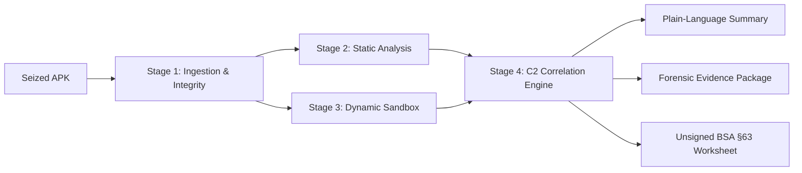
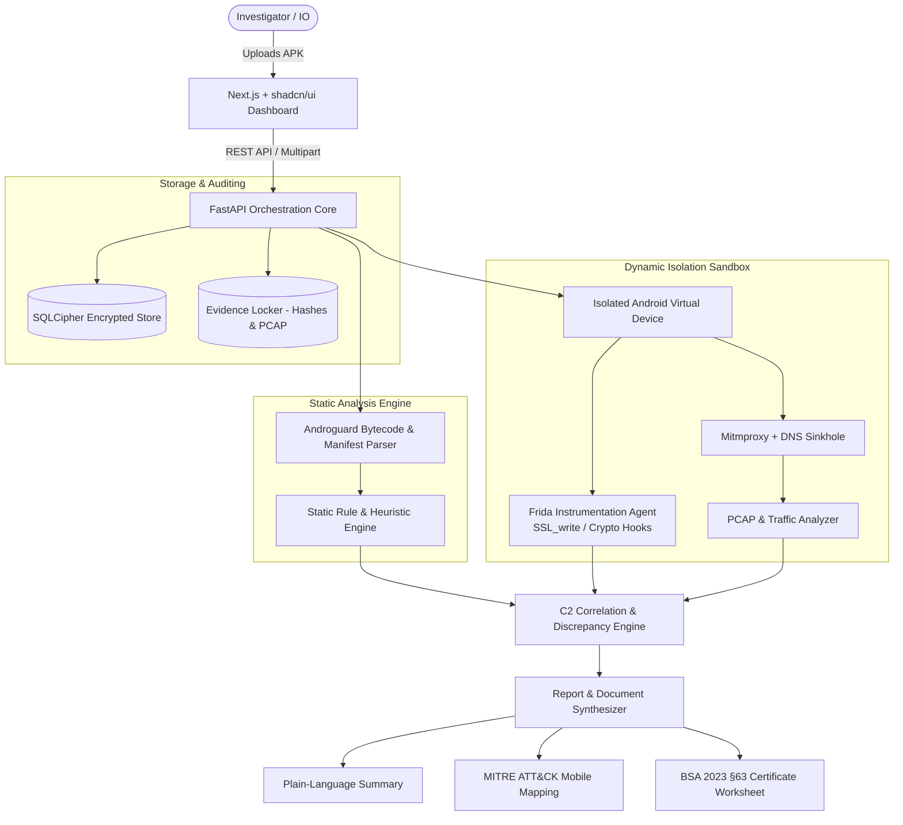

# 🛡️ APK Threat Analysis Platform — with C2 Detection

> **An automated mobile forensic & C2 triage platform built for CIDECODE 2026**  
> *(Organized by Karnataka CID, Centre for Cybercrime Investigation Training & Research [CCITR], and PES University)*

[](https://cidecode.pes.edu)
[](https://ksp.karnataka.gov.in)
[](https://indiacode.nic.in)
[](https://fastapi.tiangolo.com)
[](https://nextjs.org)

---

## 📌 Executive Summary

> **In one sentence:** An investigator uploads a suspicious Android application (APK), and within 60 seconds the tool explains — in clear, plain language — what the app secretly does, where it transmits stolen data, and generates a tamper-evident, court-ready report an investigating officer can immediately act upon.

```
       ┌────────────────┐        ┌────────────────┐        ┌────────────────┐        ┌────────────────┐
  1.   │  UPLOAD APK    │   2.   │  LOOK INSIDE   │   3.   │  SAFELY RUN    │   4.   │  ACTION REPORT │
───────┤  Suspicious    ├───────►│ Static triage  ├───────►│ Sealed sandbox ├───────►│ Plain English   │
       │  Android app   │        │ & hidden clues │        │ & unmask C2    │        │ + BSA §63 Pack │
       └────────────────┘        └────────────────┘        └────────────────┘        └────────────────┘
```

---

## 🔍 The Problem: Triage Paralysis in Cybercrime Investigations

### The Real-World Scenario
Across India, organized cyber syndicates exploit trust and urgency through malicious Android apps:
* **Predatory Instant Loan Apps:** Victims download apps promising "zero-paperwork loans." The app appears legitimate on the surface, but covertly exfiltrates private photo albums, contact lists, and SMS messages. Weeks later, aggressive extortionists threaten to blast modified images to the victim's entire contact list.
* **"Digital Arrest" & Impersonation Scams:** Victims are directed to install rogue apps claiming to be official CBI, Police, or customs verification utilities.
* **OTP & Banking Trojans:** Apps masquerading as bill-payment or courier tracking tools silently intercept banking OTPs and siphon financial accounts.

### The Investigating Officer's Dilemma
When an Investigating Officer (IO) seizes a suspect's or victim's device, they face critical hurdles:
1. **Time-Sensitive Golden Hours:** Victims are actively extorted. Delaying triage allows criminal infrastructure to rotate domains or purge Telegram/Discord channels.
2. **Forensic Bottlenecks:** Apps must be shipped to overburdened forensic science laboratories (FSL/CCITR). Analysts manually juggle decompilers, network proxies, and debuggers—often taking days or weeks.
3. **The Technical Barrier:** Most frontline police officers are legal and investigative experts, not reverse engineers. Disassembled Smali code or raw PCAP files are unhelpful during an ongoing raid or interrogation.
4. **Encryption Evasion:** Malicious apps increasingly deploy TLS pinning and encrypt payloads *before* transmission, blinding conventional network sniffers.

---

## 💡 Key Terminology (Plain English)

| Term | What It Means |
| :--- | :--- |
| **APK (Android Package)** | The installable setup file for an Android app (equivalent to a `.exe` or `.msi` on Windows). |
| **C2 (Command & Control) Server** | The cybercriminal's "mothership" or backend server that issues commands to the malware and receives stolen data (e.g., rogue web APIs, Telegram bots, Discord webhooks). |
| **Static Analysis** | Inspecting the code, manifest, permissions, and resources of an application without executing it (like an airport baggage X-ray). |
| **Dynamic Analysis** | Running the app inside an isolated, disposable sandbox to observe its real runtime behavior (like detonating a suspect device inside a sealed blast chamber). |
| **Frida Hooking** | Dynamic instrumentation that hooks into application memory, allowing the extraction of data just before it gets scrambled/encrypted by SSL libraries. |
| **BSA 2023 §63** | Section 63 of the Bharatiya Sakshya Adhiniyam, 2023 (replacing Section 65B of the Indian Evidence Act), establishing the legal framework for admissibility of electronic records in Indian courts. |

---

## ⚙️ How It Works: The 4-Stage Pipeline



### 1. Ingestion & Cryptographic Chain of Custody
* Computes dual cryptographic digests (`SHA-256`, `MD5`) immediately upon upload.
* Records submission metadata with immutable, hash-chained audit logging (backed by encrypted SQLCipher).

### 2. Static Analysis ("The Baggage X-Ray")
* Parses `AndroidManifest.xml` to flag dangerous permission combinations (e.g., `READ_CONTACTS` + `READ_SMS` + `INTERNET` requested by a "Flashlight" or "Loan Calculator").
* Decompiles Dex bytecodes to discover embedded secrets: hardcoded C2 URLs, IP addresses, Telegram bot tokens, Firebase endpoints, and command strings.
* Identifies known evasion techniques (anti-emulator checks, root detection strings, unpackers).

### 3. Dynamic Analysis in a Sealed Sandbox ("The Blast Chamber")
* Boots a clean, isolated Android Virtual Device (AVD) running in a hermetically sealed network envelope with no direct route to the live internet.
* Automatically exercises UI triggers, simulating user interactions (granting permissions, accepting dialogs).
* **Native Pre-Encryption Interception:** Instruments runtime memory via Frida (`SSL_write` hooks) to capture unencrypted HTTP/REST/Socket traffic *before* TLS encryption scrambles the payload.
* Records all outbound network connections, DNS requests, and file-system mutations.

### 4. Correlation & "Catching the Lie"
* **Discrepancy Detection:** Cross-references static declarations with actual dynamic execution. If an app claims to communicate with `https://api.legitloan.in` in its terms, but dynamically streams contacts to `https://api.telegram.org/bot.../sendMessage`, the platform flags the contradiction as a primary indicator of criminal intent.
* Maps behaviors directly to the **MITRE ATT&CK® for Mobile** framework.

---

## 🎯 What Sets This Tool Apart

* 🔓 **Intercepts Data Before Encryption:** Rather than relying solely on MITM proxying (which fails when apps use custom crypto or tight SSL pinning), native dynamic hooks capture cleartext exfiltration at the socket library boundary.
* 🤥 **Automated Discrepancy Auditing:** Spots the delta between what the app promises the user and what it secretly transmits in the background.
* 🗣️ **Investigator-First Interface:** Delivers a clear 3-tier reporting hierarchy:
  1. **Tier 1 (Frontline):** Plain-English verdict and actionable investigative leads (IP addresses, Telegram handles, bank account hooks).
  2. **Tier 2 (Forensics Lab):** Technical telemetry, PCAP traces, Frida hook logs, and decompiled code snippets.
  3. **Tier 3 (Legal & Judicial):** Pre-populated, unsigned **BSA 2023 §63** certificate worksheet with hardware hashes and tool parameters.
* 🇮🇳 **Calibrated for Indian Cybercrime Modus Operandi:** Pre-configured heuristic rules for extortion syndicates, fake micro-lenders, unauthorized APK distribution networks, and regional phishing themes.

---

## ⚖️ Forensic Integrity & Ethical Guardrails ("What This Tool Is Not")

To maintain absolute credibility with judicial bodies and police leadership, the platform enforces strict evidentiary boundaries:

> [!IMPORTANT]
> ### 1. Investigative Leads, Not a Judicial Verdict
> A **"HIGH"** or **"CRITICAL"** threat rating indicates priority for investigation. It is an algorithmic lead to guide search warrants and subpoenas, not an automated ruling of criminal guilt. A human investigator must always review findings.

> [!WARNING]
> ### 2. No Self-Certification of Electronic Evidence
> Software cannot legally testify in court. While the platform generates a comprehensive **Bharatiya Sakshya Adhiniyam (BSA) 2023 §63 / IEA 65B** technical worksheet, **the signature block is deliberately left blank**. The examining officer must review the process, verify the hash values, and execute the certificate manually.

> [!NOTE]
> ### 3. Evasion-Aware Reporting
> If sophisticated malware detects the emulator environment and remains inert, the platform **never reports "Safe" or "Clean"**. Instead, it reports **"Inconclusive — Potential Evasion Detected"**, prompting advanced manual de-obfuscation.

---

## 👥 Target Users & Impact

```
┌─────────────────────────────────┐   ┌─────────────────────────────────┐   ┌─────────────────────────────────┐
│     Frontline Police / IOs      │   │    Cyber Forensics (CCITR/FSL)  │   │     Prosecution & Judiciary     │
├─────────────────────────────────┤   ├─────────────────────────────────┤   ├─────────────────────────────────┤
│ • 60-second triage in the field │   │ • Standardized triage harness   │   │ • Legally compliant worksheets  │
│ • Clear identification of C2    │   │ • Repeatable sandbox telemetry  │   │ • Strict chain-of-custody audit │
│ • Plain-language explanations   │   │ • Native cleartext dump capture │   │ • Corroborated technical proof  │
└─────────────────────────────────┘   └─────────────────────────────────┘   └─────────────────────────────────┘
```

---

## 🏛️ System Architecture



---

## 💻 Technology Stack

### Backend & Core Analysis Engine
* **Runtime:** Python 3.11+
* **API Framework:** [FastAPI](https://fastapi.tiangolo.com/) (Asynchronous, OpenAPI-documented)
* **Static Analysis:** [Androguard](https://github.com/androguard/androguard), `apktool`
* **Dynamic Sandbox:** Android SDK Emulator (AVD), isolated bridge orchestration
* **Dynamic Hooking:** [Frida](https://frida.re/) (Native hook into `libssl.so` / `libc.so` for unencrypted traffic extraction)
* **Network Interception:** [mitmproxy](https://mitmproxy.org/) + `tcpdump` packet capture
* **Data Persistence:** [SQLCipher](https://www.zetetic.net/sqlcipher/) (AES-256 encrypted database) with hash-chained tamper detection

### Frontend & Reporting Dashboard
* **Framework:** [Next.js](https://nextjs.org/) (App Router, React 19)
* **Styling & UI:** Tailwind CSS, [shadcn/ui](https://ui.shadcn.com/), Lucide Icons
* **Data Visualization:** Interactive network topologies (C2 graph visualization) & MITRE ATT&CK matrix view
* **Report Generation:** WeasyPrint / headless PDF rendering with digital checksum verification

---

## 📂 Repository Organization

```text
├── README.md                          # Platform overview, architecture & mission (this file)
├── CLAUDE.md                          # AI agent guardrails and development guidelines
├── AGENTS.md                          # Agent workflows and operational parameters
├── docs/                              # Detailed technical specifications & guides
│   ├── pipeline-overview.md           # ⭐ End-to-end pipeline architecture & demo journey
│   ├── static-flow.md                 # Static analysis deconstruction & permission auditing
│   ├── dynamic-flow.md                # Sandbox setup, Frida hooks & SSL plaintext capture
│   ├── c2-scoring-flow.md             # Conjunctive C2 scoring & correlation logic
│   ├── report-flow.md                 # Plain-language generator & BSA 2023 §63 schema
│   └── plain-english-explainer.md     # Presentation script for non-technical leadership
├── backend/                           # FastAPI service, analysis modules & sandbox drivers
│   ├── app/
│   │   ├── api/                       # API routes (upload, status, report)
│   │   ├── static/                    # Androguard & manifest analysis
│   │   ├── dynamic/                   # AVD runner, Frida scripts & proxy hooks
│   │   ├── correlation/               # C2 scoring engine & MITRE mapping
│   │   └── legal/                     # BSA §63 certificate generator
├── frontend/                          # Next.js investigator dashboard
│   ├── src/
│   │   ├── components/                # Dashboard panels, graphs, timeline & reports
│   │   └── app/                       # App router pages
└── tests/                             # Unit tests, integration harnesses & test APK fixtures
```

---

## 🗺️ Engineering Roadmap (CIDECODE 2026)

* [x] **Phase 0: Architecture & Adversarial Review** — Complete design pass, legal compliance validation, and threat modeling.
* [ ] **Phase 1: Safe Sandbox & Dynamic Hook Spike (P0)** — Build the minimal headless AVD harness with Frida native `SSL_write` interceptor.
* [ ] **Phase 2: Static Engine Integration (P1)** — Manifest parsing, dangerous permission scoring, and regex-based token/endpoint extraction.
* [ ] **Phase 3: C2 Scoring & Discrepancy Correlator (P2)** — Connect static signatures with dynamic telemetry; calculate calibrated risk indicators.
* [ ] **Phase 4: Forensics Engine & BSA §63 Generator (P3)** — Automated packaging of evidence locker (hashes, PCAPs, raw dumps) and unsigned legal worksheets.
* [ ] **Phase 5: Investigator Dashboard (P4)** — Intuitive web interface featuring summary cards, C2 relationship graphs, and one-click PDF export.
* [ ] **Phase 6: Evasion-Resilience & Synthetic Evaluation (P5)** — Test against real-world de-fanged loan/phishing APK samples; calibrate false-positive rates.
* [ ] **Phase 7: Live Demonstration Package (P6)** — Offline-ready demo environment with sample evidence kits for the jury.

---

## 📜 Compliance & Legal Disclaimer

This software is designed strictly for lawful cybercrime investigation, digital forensics, academic research, and triage by authorized law enforcement agencies.

* **Authorization:** Running dynamic analysis on untrusted binaries must only be conducted in sealed sandbox environments under proper administrative authorization.
* **Judicial Standing:** Automated reports produced by this software are investigative aids and do not substitute for expert witness testimony or statutory procedures under the Bharatiya Sakshya Adhiniyam, 2023.

---

<p align="center">
  <b>Developed for CIDECODE 2026</b><br/>
  Empowering Law Enforcement with Actionable, Plain-Language Cyber Intelligence.
</p>